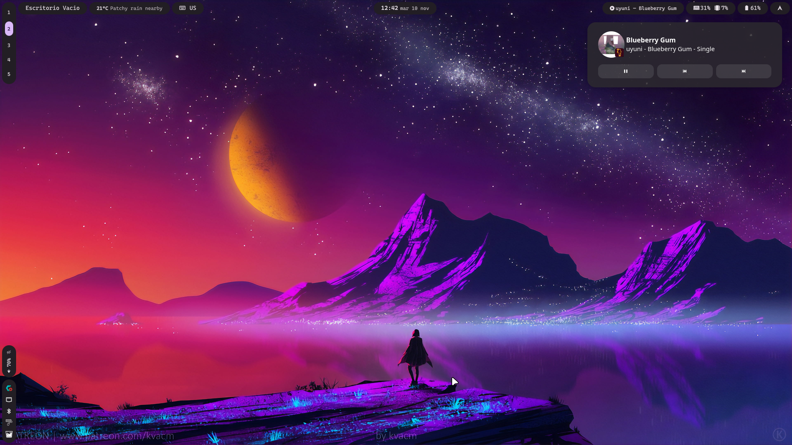

# hyprmoon

My Hyprland rice on CachyOS, with a custom bar built in Quickshell.



## What's inside?

- **Hyprland**: Wayland compositor (tiling window manager).
- **Quickshell**: Custom bar and control center.
- **Matugen**: Material You colors generated from the wallpaper.
- **Hyprlock**: Lockscreen.
- **Fuzzel**: Custom app launcher.
- **kitty**: Fast, GPU-accelerated terminal.
- **swaync**: Notifications center.
- **split-monitor-workspaces**:  Hyprland plugin: independent workspaces per monitor.
- **qt6ct / adw-gtk3**: Qt and GTK apps themed with Matugen colors.
- **ly**:  Lightweight display manager.

## Dependencies

```fish
sudo pacman -S \
    hyprland hyprlock kitty fuzzel swaync stow grim slurp qt6ct ly wl-clipboard cliphist pamixer playerctl pavucontrol libnotify brightnessctl power-profiles-daemon jq xdg-utils \
    awww network-manager-applet blueman polkit-kde-agent adw-gtk-theme papirus-icon-theme \
    thunar thunar-archive-plugin xarchiver \
    ttf-jetbrains-mono-nerd ttf-cascadia-code-nerd btop
```

From the AUR:

```fish
yay -S quickshell matugen
```

## Optional dependencies

```fish
yay -S pinta gnome-calendar zed steam
```

If you have an NVIDIA GPU, you can install the `nvidia-utils` package:

```fish
sudo pacman -S nvidia-utils
```

If you have an ASUS laptop, you can install the `rog-control-center` package:

```fish
sudo pacman -S rog-control-center
```

## Installation

> [!WARNING]
> Back up your existing configs first, or Stow will refuse to overwrite them.

```fish
for pkg in fuzzel hypr hyprlock kitty matugen qt6ct quickshell swaync
    mv ~/.config/$pkg ~/.config/$pkg.bak
end
```

```fish
cd $HOME
git clone https://github.com/MoonLy05/hyprmoon.git
cd hyprmoon
stow -t ~ fuzzel hypr hyprlock kitty matugen qt6ct quickshell swaync
```

## Manual steps

1. **Install the workspace plugin** (after running `stow`, since it lives inside the Hyprland config):

```fish
mkdir -p ~/.config/hypr/plugins
cd ~/.config/hypr/plugins
git clone https://github.com/zjeffer/split-monitor-workspaces
```

2. **Add your wallpapers** to `~/wallpapers`. The random wallpaper script picks images from there:

```fish
mkdir -p ~/wallpapers
```

3. **Add a profile picture** at `~/.face`. It's used by Hyprlock and the control center.